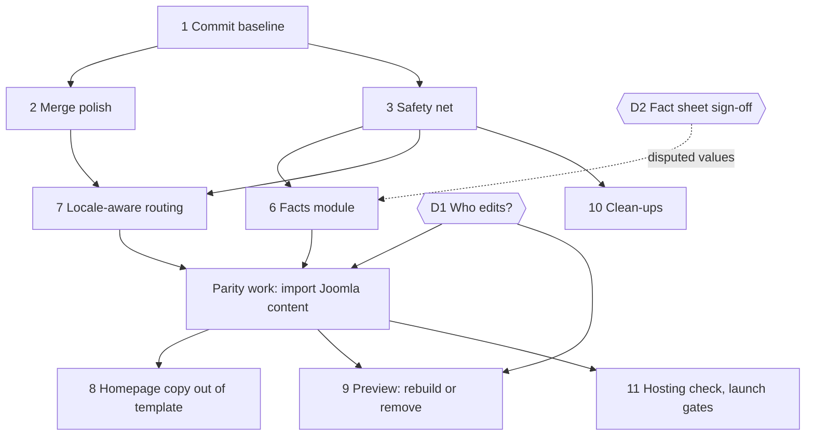

# Fixing the build's shortcomings: order and dependencies

**Date:** 2026-11-24 · **Status:** proposal, nothing started except the polish branch.

**Premise:** Joomla stays the live site until this build is solid. So nothing here is urgent for visitors, and the order is chosen to make the parity work (`2026-11-24-joomla-parity.md`) cheaper, not to reach a launch date.

## The order

| # | Step | Why at this point | Needs first | Size |
|---|---|---|---|---|
| 1 | **Commit the baseline**: pending news redirects in `vercel.json`, audit and plan docs | Everything later should diff against a clean tree | nothing | 15 min |
| 2 | **Merge the polish branch** after Carlo's comments on the before/after page | New templates in the parity work should inherit the fixed header, footer and product layout | 1, Carlo's comments | 1–2 h |
| 3 | **Safety net in the build**: `astro check`, a link check over `dist/`, a phone-width overflow check, the parity check | Every later step touches many pages. These four checks would have caught the dead homepage link, the phone overflow and the broken Leistungen redirects | 1 | 0.5 day |
| 4 | **Decision D1: who edits content?** (Carlo) | Decides whether Sanity and the draft preview stay. Blocks 7, 9 and the import design in the parity plan | nothing | a conversation |
| 5 | **Decision D2: fact sheet v0.2 signed off** (Philipp) | Blocks the disputed values only: ±0,1 vs ±0,6 mm, 1983 vs 1985, canonical email | nothing | Philipp |
| 6 | **Facts module**: one source for payload, accuracy, founding year, addresses, email, LinkedIn; pages, JSON-LD and `llms.txt` read from it. Add group and sister-company JSON-LD | Removes the whole class of contradiction. Do it before importing Joomla content, so imported pages can be checked against it | 3; 5 for disputed values (undisputed ones can go first) | 1 day |
| 7 | **Locale-aware routing**: one template set that takes the language as a parameter, real `/en/` routes, hreflang pairs. Delete the `/en` smoke-test page as part of it | Must come before any new template. Otherwise every page type built for parity is built twice | 2, 3 | 1.5–2 days |
| 8 | **Homepage and Kontakt copy out of the templates** | Homepage is 1,165 lines with all copy inline. It will be reworked anyway (parity, design directions), so only move facts now (step 6) and move the copy when the homepage is rebuilt | 6, 4 | with the homepage rebuild |
| 9 | **Draft preview through the real templates**, or remove the preview feature | Only worth doing once the templates are stable, and only if D1 says someone other than Carlo edits | 4, 7, parity templates done | 1 day or a deletion |
| 10 | **Small clean-ups**: remove duplicate `/ueber-krups`, prerender the sitemap, `SITE_URL` from env, move `public/hero-pick.html` out | Independent | 3 | 2 h |
| 11 | **Hosting check**: confirm the Vercel plan allows a commercial site; set `N8N_CONTACT_WEBHOOK` | Launch gate only | nothing | 15 min |

## Dependencies at a glance

## What can run in parallel

- Steps 1, 4, 5 and 11 need no code and no one else's output. Start them together.
- Steps 3 and 2 are independent of each other.
- Step 6 can start with the undisputed facts (payload 50–2.000 kg, addresses, PL d, 48 V) while D2 is open.

## What I would not do

- **Not** rewrite away from Sanity now. The cost is paid. Revisit only if D1 says nobody but Carlo will ever edit.
- **Not** fix the hardcoded homepage copy line by line. The facts module removes the wrong numbers; the rest waits for the rebuild.
- **Not** build tests for the query layer. The four build checks in step 3 cover the failures this project has actually had.
