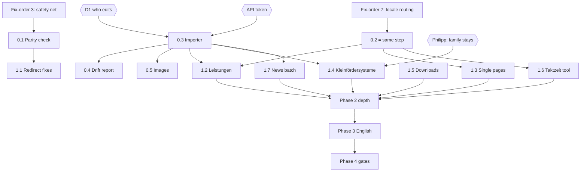

# Bringing the Astro build up to Joomla: content and structure

**Date:** 2026-11-24 · **Status:** proposal.
**Premise:** Joomla stays live and keeps changing until this build is solid. The plan therefore has to (a) close the gap and (b) keep it closed while Joomla moves.

**Inventory behind this plan:** `2026-11-24-joomla-live-inventory.csv`, 111 Joomla URLs fetched on 2026-11-24 (status, redirect target, word count, images, forms, PDFs, JSON-LD blocks, meta description length). News is covered separately by `2026-11-04-news-archive-inventory.csv` (118 items).

---

## 1. Where the two sites stand today

### Joomla, live content pages (excluding news)

| Language | Live pages | Astro has an equivalent | Page exists in Astro, redirect wrong | Content missing in Astro |
|---|---|---|---|---|
| DE | 40 | 11 | 5 | 24 |
| EN | 37 | 0 | 0 | 37 |

Plus news: 70 DE and 48 EN items on Joomla, none in Astro.

### The 24 missing DE pages, by section

| Section | Pages | Words on Joomla | Source material | Note |
|---|---|---|---|---|
| Leistungen, life-cycle structure | hub + 5 phase pages (the 6th, Service, exists with old text) | 487 + 293–513 each | `website/leistungen-pages/phasen/release/` (DE), `phasen/en/body-en/` (EN), FAQ JSON in `phasen/en/faq-jsonld/` | Astro still has the six competency pages that Joomla retired on 2026-11-20 |
| Kleinfördersysteme | overview + 6 product pages | about 1,800 in total | live pages; three older mockups in `website/kleinfoerdersysteme/` | Whole product family missing. Small pages, 2–8 images each |
| Medien & Downloads | 6 category pages | thin, they list files | Joomla download component | The Joomla sitemap lists 23 downloadable files, Astro has 13. Categories missing in Astro: 3D-Modelle, Planungstools, Videos, Lieferanten- und Kundeninformationen |
| Taktzeitberechnung | 1 | 393 | page JavaScript on Joomla | A working tool: four calculators (Station zu Station, Drehmodul, Lift, Shuttle), 32 inputs |
| Single pages | Sonderentwicklungen, Nachhaltigkeit, Mission Statement | 183, 335, 182 | live pages | Fit the existing generic page renderer |
| News overview | 1 | list page | see news plan | Needs `/journal` |

### The 5 with a wrong redirect

`logo-mat-e-serie`, `logo-mat-l-serie`, `logo-mat-xl-serie`, `logo-mat-t-serie` and `unternehmen-uebersicht` fall through to the homepage, although Astro has the matching page. Five lines in `vercel.json`.

### Things Joomla no longer has (so Astro does not need them)

- **Karriere:** `/de/karriere/stellenangebote` redirects to `krups-group.com/karriere`; the other career URLs return 404. Astro needs a link, not pages.
- **Die KRUPS Group, Historie:** both return 404 on Joomla.

### Where Astro is ahead

- Five industry pages against one "Anwendungsbereiche" page on Joomla.
- `/planung` (production planning) has no Joomla counterpart.
- Product data is structured (spec rows, features, FAQ) instead of free HTML.

### Depth on pages both sites have (not yet compared)

Joomla's eCart family page has 1,705 words plus 659 on the E-Serie page; the friction roller page 1,496; L, XL and T 390–504 each. The Astro versions were imported in June and Joomla has been edited since (164 meta descriptions on 2026-11-23, FAQ markup, homepage changes). A text diff is step 2.2 below.

---

## 2. The plan

### Phase 0: foundations (before any content is ported)

| # | Step | Detail | Needs |
|---|---|---|---|
| 0.1 | Parity check in the repo | Script that reads the inventory CSV, applies `vercel.json` and the built routes, and prints the table from section 1. This number is the progress bar and later the launch gate | fix-order step 3 |
| 0.2 | Locale-aware routing | One template set for DE and EN (fix-order step 7) | fix-order steps 2, 3 |
| 0.3 | Import pipeline from Joomla | One re-runnable importer instead of hand-porting. Preferred source: Joomla's web services API (raw article HTML, `created` and `modified` dates, language associations, meta description). Fallback: the public HTML. Output: Sanity documents with deterministic IDs, so a re-run updates in place, plus a JSON snapshot per page in git so every re-import shows as a diff | D1 (decided: importer runs until cutover only, then Sanity is the source); an API token from Carlo |
| 0.4 | Drift report | Weekly job (n8n fits) that hashes each Joomla page's main content and meta description and lists what changed since the last import. Replaces a manual "to port" list | 0.3 |
| 0.5 | Image pipeline | Bring the real photo set from Joomla into Sanity assets. The Astro build currently uses none of it | 0.3 |

### Phase 1: German structure parity

Ordered by value per effort. Each row ends with the parity count it closes.

| # | Step | What gets built | Decisions | Size | Closes |
|---|---|---|---|---|---|
| 1.1 | Redirect fixes | 5 missing series and overview rules; replace the `/de/leistungen/:slug` pass-through with the explicit rules Joomla already runs | none | 1 h | 5 |
| 1.2 | Leistungen life cycle | Hub + 6 phase pages from the released texts, FAQ with JSON-LD, anchors for the four Fertigung blocks, 10 redirects copied from Joomla. `service` schema gets phase number and role; the six competency documents are retired | none: content is approved and live | 1.5 days | 6 |
| 1.3 | Single pages | Sonderentwicklungen, Nachhaltigkeit, Mission Statement as `page` documents; Karriere and KRUPS Group as links to krups-group.com | none | 0.5 day | 3 |
| 1.4 | Kleinfördersysteme | New product family + 6 products on the existing family and product templates; spec rows from the KF-30 and KF-50 data sheets where they exist | Philipp: confirm the family stays on the site | 1.5 days | 7 |
| 1.5 | Downloads | Add the roughly 10 missing files and the 4 missing categories to the one filterable `/downloads` page; redirect the 6 category URLs to it with a filter anchor. Check first whether any Joomla download needs a login (Joomla has login and registration pages) | Carlo: gated downloads yes or no | 0.5–1 day | 6 |
| 1.6 | Taktzeitberechnung | Port the four calculators as one plain-JavaScript component. Take the formulas from the Joomla page, and test them against Joomla's results for a set of inputs | Philipp: keep the tool (it is linked from downloads as well) | 1.5–2 days | 1 |
| 1.7 | News, first batch | Per `2026-11-04-news-migration.md`: `/journal` index and article page, import about 10 of the 22 "migrate" items with real publish dates from the API, retarget their redirects | Carlo: batch; Philipp: MTU naming | 2 days | 1 + batch |
| 1.8 | Homepage | Port the definition block and the 2026-11-23 changes; rebuild from facts module. Best done together with the design direction, once one is chosen | design direction | open | 0 (page exists) |

After 1.1–1.7: 40 of 40 German content pages have an equivalent or a deliberate target.

### Phase 2: depth parity on pages both sites have

| # | Step | Detail | Size |
|---|---|---|---|
| 2.1 | Meta descriptions | Import the 164 descriptions deployed on Joomla (logs in `website/meta-batch-a/` and `meta-batch-b/`) into the matching Astro pages. Fixes the homepage's fallback description | 0.5 day with 0.3 |
| 2.2 | Text diff, product pages | Diff Joomla against Sanity for eCart, E-Serie, friction rollers, L, XL, T. Port what is newer; check every number against the facts module | 1 day |
| 2.3 | Structured data | Joomla product pages carry 5 JSON-LD blocks. Compare block by block with Astro's output | 0.5 day |
| 2.4 | Anwendungsbereiche | Confirm nothing on Joomla's single page (14 images) is missing from the five industry pages | 2 h |

### Phase 3: English

37 content pages and 48 news items. With 0.2 and 0.3 in place this is an import, not a rebuild.

| # | Step | Detail | Decisions |
|---|---|---|---|
| 3.1 | Import EN content | Same importer, EN language; pair DE and EN through Joomla's associations for hreflang | US or British English: Joomla is en-GB, the standing rule for new English content is US |
| 3.2 | EN gaps on Joomla itself | Going by the sitemap, 2 of 6 Kleinfördersysteme pages have no English version, and the English T-Series page is not listed (earlier notes say it exists). Verify both against the admin | translate or leave out |
| 3.3 | EN redirects | Replace the 30 "English URL to German page" rules with real EN targets; add rules for the 6 EN URLs that have none | none |

### Phase 4: gates before cutover

1. Parity check: every live Joomla URL resolves to an equivalent page or to a target someone signed off.
2. Facts check passes on all pages, both languages.
3. Contact form delivers (webhook set in Vercel); Datenschutz text reviewed (it names Google Analytics, the build uses PostHog).
4. Drift report shows no unported change.
5. Philipp has clicked through the site.

---

## 3. Order and dependencies

Steps 1.1 and 1.5 depend on nothing in Phase 0 and can start at once. 1.2 could also be done by hand from the released files without waiting for the importer, since that content is already local.

Rough total for Phases 0–2: 12–15 working days. Phase 3 adds 3–5. These are estimates, not measured.

---

## 4. Suggestions beyond a 1:1 copy

1. **Import by script, never by hand.** With Joomla still moving, a hand-ported page is stale the day after. The importer plus the drift report is what makes "catch up" a finite task.
2. **Do not port everything.** The news triage already retires 55 of 118 items. Merge the six download category pages into one filterable page. Fold the E-Serie page into the eCart page (already the case). Skip the two overview tile pages.
3. **Fix the Joomla sitemap now.** `sitemap-de.xml` and `sitemap-en.xml` list 13 URLs that return 404, the retired Leistungen URLs, login and registration pages and 34 file-download task URLs, and they do not list the new phase pages. `robots.txt` has no `Sitemap:` line. This matters for the live site today and should be corrected before the sitemaps are submitted in Search Console.
4. **Give the download pages a meta description.** 18 live Joomla pages have none: the media and downloads section, the news overviews and the company overview, in both languages. The news overview texts are already in the pending site-fix round.
5. **Use the real photos.** The live site has a professional photo set; the Astro build has generated drawings.
6. **Connect the takt-time calculator to the contact form.** Carry the entered values into the enquiry, so a calculation becomes a lead.
7. **Decide English once.** US or British spelling, and whether English launches with German or after it. Launching German-only would take 37 English pages offline.
8. **Make "solid enough" a number.** The parity check gives one: today 11 of 40 German pages and 0 of 37 English pages are covered.

---

## 5. Open decisions

| # | Decision | Owner | Blocks |
|---|---|---|---|
| D1 | Who edits content after launch? DECIDED 2026-11-25: Carlo at first, then Julia; see fix-order "Editor handover" | Carlo | 0.3 design, preview feature |
| D2 | Fact sheet v0.2 sign-off | Philipp | disputed facts |
| D3 | Joomla API token for the importer | Carlo | 0.3 (fallback: public HTML, no dates) |
| D4 | Kleinfördersysteme stays on the site | Philipp | 1.4 |
| D5 | Takt-time tool stays | Philipp | 1.6 |
| D6 | Any gated downloads? | Carlo | 1.5 |
| D7 | US or British English; English at launch or later | Carlo, Philipp | Phase 3 |
| D8 | News: first batch, MTU naming | Carlo, Philipp | 1.7 |
